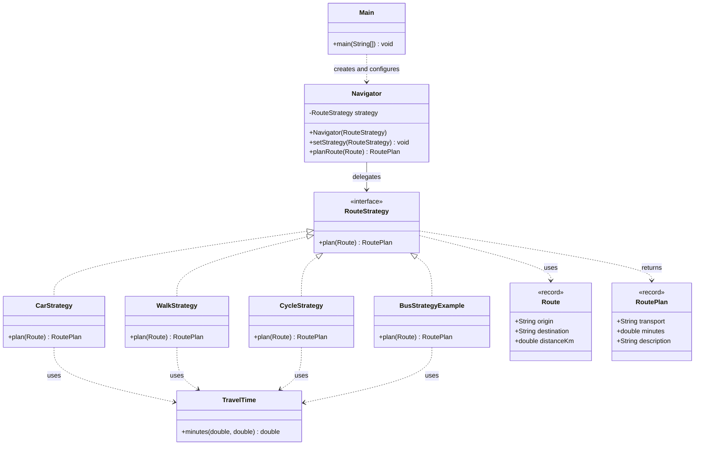

# Assignment #5 — Strategy Pattern

**Student:** Zhuldyz Yelbayeva  
**Group:** SE-2522  
**Course:** Software Design Patterns  
**University:** Astana IT University  
**Academic Year:** 2026–2027  
**GitHub:** https://github.com/zhuldyzyelbayeva-spec/assignment-5-strategy-pattern-Copy.git

## 1. Introduction

The chosen domain is Navigation / Route Planning (Option A). The project demonstrates the Strategy behavioral design pattern in Java 17.

The application estimates travel time for a route using four interchangeable transportation strategies:

- **CarStrategy:** 40 km/h
- **WalkStrategy:** 5 km/h
- **CycleStrategy:** 15 km/h
- **BusStrategyExample:** 25 km/h

Each strategy implements the `RouteStrategy` interface and provides its own travel-time calculation. These speeds are simplified estimates rather than real-world traffic or navigation data.

The `Navigator` class acts as the Context. It stores a reference to `RouteStrategy` and delegates route planning to the currently selected strategy.

The client (`Main`) can change the strategy at runtime using `setStrategy()` without modifying the `Navigator` class.

This approach replaces conditional logic with polymorphism and makes the application easier to extend, maintain, and test.

## 2. UML Class Diagram



The UML diagram represents the main components of the Strategy pattern:

- **Strategy Interface:** `RouteStrategy`
- **Concrete Strategies:** `CarStrategy`, `WalkStrategy`, `CycleStrategy`, `BusStrategyExample`
- **Context:** `Navigator`
- **Client:** `Main`

The `Route` record stores route information, while `RoutePlan` stores the calculated result. `TravelTime` provides a shared calculation method.

## 3. Clean Code Principles

The implementation demonstrates six Clean Code principles. The Before examples are illustrative comparisons, while the After examples represent the implemented design.

### 3.1 Elimination of Conditional Logic Through Polymorphism

**Before:**

A conditional-based implementation would require checking the selected transportation type.

```java
if (mode.equals("car")) {
    return distanceKm / 40.0 * 60.0;
} else if (mode.equals("walk")) {
    return distanceKm / 5.0 * 60.0;
}
```

Adding another transportation mode would require modifying this conditional structure.

**After — Navigator.java:**

```java
public RoutePlan planRoute(Route route) {
    return strategy.plan(
        Objects.requireNonNull(route, "Route is required")
    );
}
```

The `Navigator` delegates execution to the selected strategy through the `RouteStrategy` interface.

This eliminates transportation-specific conditional logic from the Context and makes algorithm switching more flexible.

### 3.2 Meaningful and Intention-Revealing Names

**Before:**

```java
class S1 {
    // Algorithm implementation
}
```

The name `S1` does not explain the responsibility of the class.

**After:**

```java
CarStrategy
WalkStrategy
CycleStrategy
BusStrategyExample
RouteStrategy
Navigator
planRoute()
setStrategy()
```

The class and method names clearly describe their responsibilities.

Meaningful naming improves readability and makes the code easier to understand without excessive comments.

### 3.3 Single Responsibility Principle

**Before:**

A single `Navigator` class could contain all transportation calculations, route management, and strategy selection logic.

Such a design would give the class multiple responsibilities.

**After — WalkStrategy.java:**

```java
public RoutePlan plan(Route route) {
    double minutes = TravelTime.minutes(
        route.distanceKm(),
        AVERAGE_SPEED_KMH
    );

    return new RoutePlan(
        "Walk",
        minutes,
        "Estimated walking time"
    );
}
```

Each concrete strategy is responsible for one transportation algorithm.

The `Navigator` manages delegation, while individual strategies implement their calculations.

This separation makes the application easier to maintain and test.

### 3.4 Dependency on Abstraction

**Before:**

```java
private CarStrategy strategy;
```

This design directly couples the Context to a specific implementation.

**After — Navigator.java:**

```java
private RouteStrategy strategy;
```

The `Navigator` depends on the `RouteStrategy` interface rather than concrete classes.

Any implementation of this interface can be supplied to the Context.

For example, the test uses a custom strategy:

```java
RouteStrategy stub = r ->
    new RoutePlan(
        "Stub",
        7.0,
        "Test-only strategy"
    );

navigator.setStrategy(stub);
```

This demonstrates that the Context can work with a new implementation without modification.

Depending on abstractions reduces coupling and improves testability.

### 3.5 Open/Closed Principle

The Open/Closed Principle states that software components should be open for extension but closed for modification.

**Before:**

In a conditional-based design, adding bus transportation would require another condition:

```java
else if (mode.equals("bus")) {
    return distanceKm / 25.0 * 60.0;
}
```

**After — Main.java:**

```java
navigator.setStrategy(
    new BusStrategyExample()
);
```

`BusStrategyExample` implements the existing `RouteStrategy` interface.

The new transportation algorithm can be introduced without changing the implementation of `Navigator`.

Only the new strategy and the client configuration are needed.

This demonstrates extensibility through polymorphism.

### 3.6 Avoiding Code Duplication and Magic Numbers

**Before:**

```java
double minutes = distanceKm / speedKmh * 60.0;
```

Repeating the same formula in multiple strategies introduces duplication. The value `60.0` also does not explain its meaning.

**After:**

```java
double minutes = TravelTime.minutes(
    route.distanceKm(),
    AVERAGE_SPEED_KMH
);
```

The `TravelTime` utility contains the shared calculation and defines a named constant for the number of minutes in an hour.

It also validates numerical inputs.

This improves consistency, readability, and maintainability while keeping the `RouteStrategy` interface focused on route planning.

## 4. Strategy vs. State Pattern

Strategy and State are both behavioral design patterns that use composition and polymorphism, but they solve different problems.

The **Strategy pattern** provides interchangeable algorithms that can be selected by the client. In this project, the client chooses a transportation strategy such as Car, Walk, Cycle, or Bus. The selected algorithm can be changed at runtime using `setStrategy()`.

The **State pattern** changes an object's behavior according to its current internal state. For example, an order may move through the states `New → Paid → Shipped`, with different operations available in each state.

The main difference is that Strategy focuses on selecting an algorithm, while State focuses on behavior associated with an object's lifecycle and state transitions.

Strategy is more appropriate for this project because transportation modes represent alternative algorithms selected externally rather than internal lifecycle states of the Navigator.

## 5. Conclusion

The Strategy pattern improves the flexibility and maintainability of the route-planning application by separating transportation algorithms into independent classes.

The `Navigator` works through the `RouteStrategy` interface and supports runtime strategy switching without transportation-specific conditional statements.

The implementation demonstrates important Clean Code principles, including Single Responsibility, meaningful naming, dependency on abstractions, elimination of conditional logic, and the Open/Closed Principle.

The `BusStrategyExample` demonstrates how the application can be extended without modifying the existing Context.

The main tradeoff is the increased number of classes and the need for explicit strategy configuration.

Overall, the Strategy pattern provides a clear, extensible, and testable design for applications that require interchangeable algorithms.

## 6. GitHub Repository

**Repository:** https://github.com/zhuldyzyelbayeva-spec/assignment-5-strategy-pattern-Copy.git

## References

1. Astana IT University. (2026–2027). *Assignment #5 — Strategy Pattern*. Software Design Patterns, ShP-2216.
2. Project implementation and testing examples developed with AI-assisted reference support (ChatGPT, OpenAI, 2026).
