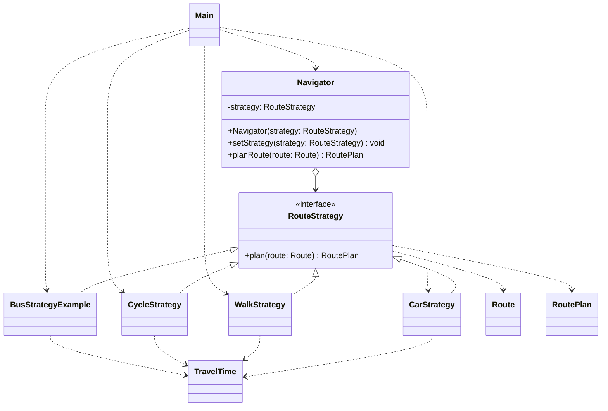

# Assignment #5 — Strategy Pattern (Report example)

**Student:** Zhuldyz Yelbayeva, SE-2522 (verify before using)  
**GitHub:** https://github.com/zhuldyzyelbayeva-spec/assignment-5-strategy-pattern-Copy.git

## 1. Introduction
The chosen domain is navigation / route planning (Option A). Four interchangeable algorithms estimate travel time from distance using different average speeds: car (40 km/h), walking (5 km/h), and cycling (15 km/h), and bus (25 km/h). These are illustrative estimates, not real road directions. The `Navigator` context delegates work to a `RouteStrategy`, which can be replaced at runtime.

## 2. UML class diagram


## 3. Clean Code — five principles and annotated examples

The following before snippets are **hypothetical contrasts**, not a claim that they appeared in this repository's history.

**Illustrative conditional-based design (not used by the actual Navigator):**
```java
// Anti-example: new transport types require editing this method.
double estimate(String mode, double distanceKm) {
    if (mode.equals("car")) return distanceKm / 40.0 * 60.0;
    else if (mode.equals("walk")) return distanceKm / 5.0 * 60.0;
    else throw new IllegalArgumentException("Unsupported mode");
}
```


### 3.1 Replace branching with polymorphism
**Before (illustrative anti-example):**
```java
// if (mode.equals("car")) ... else if (mode.equals("walk")) ...
```
**After (`Navigator.java`):**
```java
return strategy.plan(Objects.requireNonNull(route, "Route is required"));
```
The context delegates through the interface instead of branching on transport type.

### 3.2 Meaningful names
**Before (illustrative):** `class S1 { ... }`  
**After:** `CarStrategy`, `WalkStrategy`, `CycleStrategy`, `BusStrategyExample`, `planRoute`. The names show intent without requiring comments.

### 3.3 Single Responsibility Principle
**Before (illustrative):** a single navigator computes car, walking, and cycling times.  
**After (`WalkStrategy.java`):**
```java
public RoutePlan plan(Route route) {
    double minutes = TravelTime.minutes(route.distanceKm(), AVERAGE_SPEED_KMH);
    return new RoutePlan("Walk", minutes, "Estimated walking time");
}
```
Each concrete strategy encapsulates one transport algorithm.

### 3.4 Dependency on abstraction / algorithm-agnostic context
**Before (illustrative):** `private CarStrategy strategy;`  
**After (`Navigator.java`):**
```java
private RouteStrategy strategy;
```
`Navigator` does not depend on any concrete transport class. In `NavigatorTest`, a lambda implementation of `RouteStrategy` is substituted without changing `Navigator`, demonstrating dependency on the interface.

### 3.5 Open/Closed Principle (extensibility)
**Before (illustrative):** a new bus mode requires another `else if` in the context.  
**After (`BusStrategyExample.java`, `Main.java`):**
```java
navigator.setStrategy(new BusStrategyExample());
```
The bus algorithm is introduced by adding a new class and selecting it in client code; `Navigator` remains unchanged.

### 3.6 Extract shared calculation and remove magic numbers (extra)
**Before (illustrative):** `distanceKm / speedKmh * 60.0` was repeated in strategy classes.
**After:** `TravelTime.minutes(distanceKm, speedKmh)` defines `MINUTES_PER_HOUR` once and validates inputs. This utility is package-private, while `RouteStrategy` remains an interface.

## 4. Strategy vs. State
Strategy represents interchangeable algorithms chosen by the client for a task. Here, `Main` selects the desired transportation calculation and can change it with `setStrategy`. State also uses polymorphism, but its purpose is to vary an object's behavior according to its internal state, with transitions often driven by events or state objects (for example, an order moving from New to Paid to Shipped). Navigation mode here is an external algorithm choice, so Strategy is more appropriate.

## 5. Conclusion
Strategy makes the navigator easier to extend and test by isolating travel-time algorithms and avoiding mode-based conditionals inside the context. The tradeoff is more classes and an explicit configuration step. The estimates are simplified and should not be presented as real-world navigation results.

## 6. GitHub repository
Add your real GitHub repository URL here after publishing. A ZIP cannot provide a genuine remote repository or an incremental personal commit history.

## References
- Assignment #5 — Strategy Pattern, AITU, academic year 2026–2027 (provided task specification).

